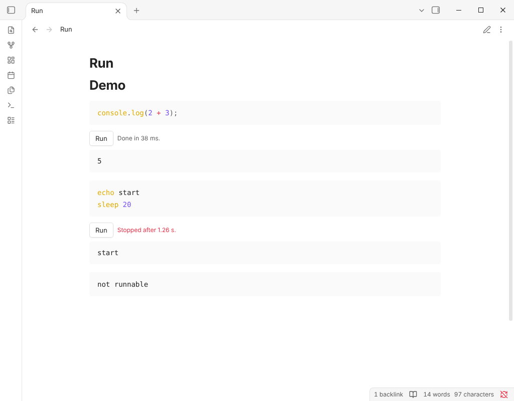
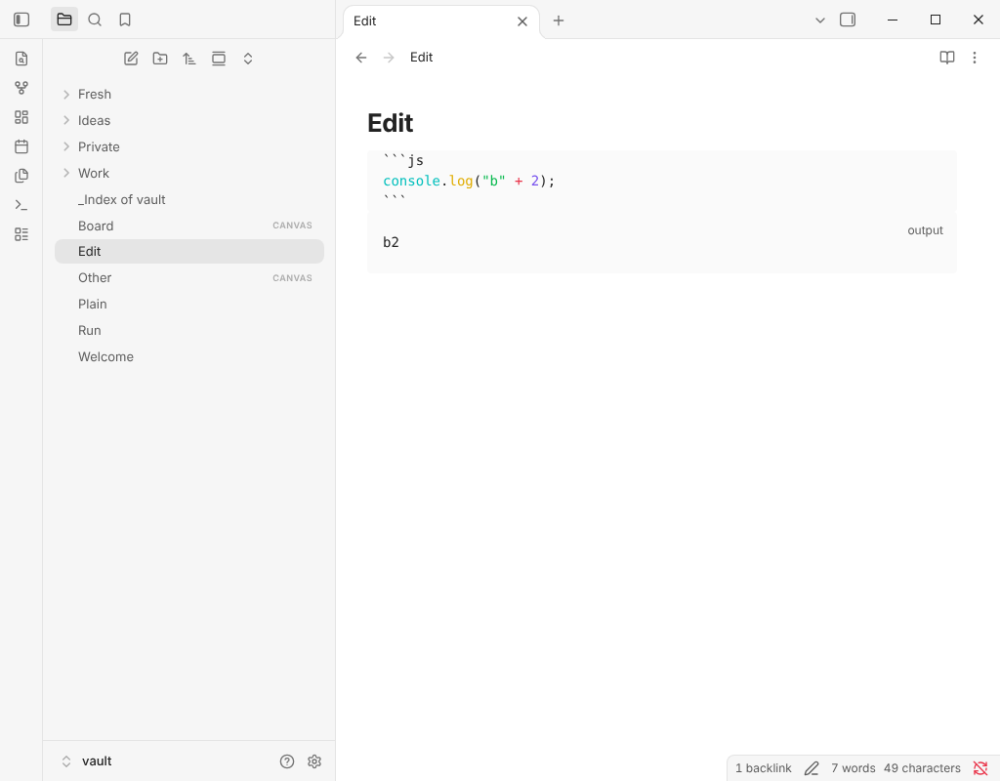

# Run Code Blocks

Adds a Run button to code blocks and shows the output right below, for JavaScript, Python, shell and more.

## Why this one

- **Output as it happens.** Text appears while the program runs, and the same button turns into **Stop**.
- **Stop really stops.** It ends the script and anything the script started, so a forgotten `sleep` or server does not keep running.
- **A time limit and an output limit.** Runs end after 30 seconds by default, and very long output is cut with a note saying how much was dropped.
- **Your own tools.** Each language uses the program you already have, and you can point it at a full path or add flags, such as `python3 -u`.
- **Asks once.** Code runs with your own permissions, so the first Run explains that and waits for a yes.

## Usage

**In reading view**, every block in a supported language gets a **Run** button. Click it: the output appears below the block, with a line saying how it ended (done, exited with an error code, stopped, or past the time limit).

**In editing view**, put the cursor in a block and run **Run code block at cursor and insert its output** from the command palette. The output is written as an `output` block right under the code, and running again replaces it, so it never piles up.

**Stop all running code** is also in the command palette while something is running.

Supported fences (each needs its program installed and on your PATH):

| Language | Fence names | Program |
| --- | --- | --- |
| JavaScript | `js`, `javascript`, `node` | `node` |
| TypeScript | `ts`, `typescript` | `node` (type stripping, Node 22.6 or later) |
| Python | `python`, `py`, `python3` | `python3` (`python` on Windows) |
| Bash | `bash`, `sh`, `shell` | `bash` |
| Zsh | `zsh` | `zsh` |
| PowerShell | `powershell`, `ps1`, `pwsh` | `pwsh` (`powershell` on Windows) |
| Ruby, PHP, Perl, Lua, R, Go | `ruby`/`rb`, `php`, `perl`/`pl`, `lua`, `r`, `go`/`golang` | `ruby`, `php`, `perl`, `lua`, `Rscript`, `go run` |

If a program is not found, the line under the block says which one and where to set its path.

## Settings

Time limit, output limit, whether programs start in the vault root or in the note's folder, and a program override for each language.

## Safety

Code runs on your computer with your permissions, exactly as if you had typed it in a terminal. It can read, change or delete files and use the network. Only run code you wrote or trust, including code in notes from other people. Nothing is run unless you click Run or use the command, and the plugin does not send anything anywhere.

Desktop only: it needs Node's child processes, which mobile does not have.

## Installation

In Obsidian, open **Settings → Community plugins → Browse** and search for "Run Code Blocks".

## More plugins by Siulved54

| Plugin | What it does | Source |
| --- | --- | --- |
| [Shared Blocks](https://obsidian.md/plugins?id=shared-blocks) | Write a block of text once and reuse it in any note. Edit the source and every reference re-renders live. | [shared-blocks](https://github.com/perezamadorluisenrique-gif/shared-blocks) |
| [Text Case and Cleanup](https://obsidian.md/plugins?id=text-format) | Change case, make camelCase or slugs, sort lines and remove duplicates, and repair text pasted out of a PDF, without touching code or URLs. | [text-format](https://github.com/perezamadorluisenrique-gif/text-format) |
| [Typography as You Type](https://obsidian.md/plugins?id=typography-as-you-type) | Curly quotes, dashes and ellipses as you type, kept out of code and maths, with Backspace to take one back. | [smart-typography-plugin](https://github.com/perezamadorluisenrique-gif/smart-typography-plugin) |
| [Section Numbering](https://obsidian.md/plugins?id=section-numbering) | Number headings as an outline (1, 1.1, 1.2) and keep every link to them working when they renumber. | [section-numbering](https://github.com/perezamadorluisenrique-gif/section-numbering) |
| [Spreadsheet to Table](https://obsidian.md/plugins?id=spreadsheet-to-table) | Paste cells from Excel or Google Sheets as a Markdown table with a real header, insert CSV files, and copy tables back out. | [spreadsheet-to-table](https://github.com/perezamadorluisenrique-gif/spreadsheet-to-table) |
| [Hybrid Line Numbers](https://obsidian.md/plugins?id=hybrid-line-numbers) | Relative and hybrid line numbers for Vim-style jumps, where a folded section counts as one line. | [hybrid-line-numbers](https://github.com/perezamadorluisenrique-gif/hybrid-line-numbers) |
| [List Item Callouts](https://obsidian.md/plugins?id=list-item-callouts) | Colour a single list item as a callout by starting it with a character such as `&`, `!` or `?`. | [list-item-callouts](https://github.com/perezamadorluisenrique-gif/list-item-callouts) |
| [Folder Counts](https://obsidian.md/plugins?id=folder-counts) | See how many notes or files each folder holds, right in the file explorer, with a vault total and folder exclusions. | [folder-counts](https://github.com/perezamadorluisenrique-gif/folder-counts) |
| [Note Reading Time](https://obsidian.md/plugins?id=note-reading-time) | Reading time of the current note or your selection in the status bar, optionally saved to a property. | [note-reading-time](https://github.com/perezamadorluisenrique-gif/note-reading-time) |
| [Task Rollover](https://obsidian.md/plugins?id=task-rollover) | Roll unfinished tasks from your last daily note into today's when it is created, with a real undo. | [task-rollover](https://github.com/perezamadorluisenrique-gif/task-rollover) |
| [Zoom Into Section](https://obsidian.md/plugins?id=zoom-into-section) | Zoom into a heading or list item to see only it and its contents, with a breadcrumb bar to climb back out. | [zoom-into-section](https://github.com/perezamadorluisenrique-gif/zoom-into-section) |
| [Link Title on Paste](https://obsidian.md/plugins?id=link-title-on-paste) | Paste a web address and get a Markdown link with the page's title, fetched in the background and undone in one step. | [link-title-on-paste](https://github.com/perezamadorluisenrique-gif/link-title-on-paste) |
| [Update Radar](https://obsidian.md/plugins?id=update-radar) | Checks your installed community plugins for updates in the background, shows what changed, and flags the ones that look abandoned. | [community-update-checker](https://github.com/perezamadorluisenrique-gif/community-update-checker) |
| [Dataview to Bases](https://obsidian.md/plugins?id=dataview-to-bases) | Convert Dataview queries into Bases blocks, and see which queries in your vault can be converted. | [dataview-to-bases](https://github.com/perezamadorluisenrique-gif/dataview-to-bases) |
| [Line Editing Commands](https://obsidian.md/plugins?id=line-editing-commands) | Duplicate, join, sort and reverse lines, insert blank lines and jump to a line number, with multi-cursor support. | [line-editing-commands](https://github.com/perezamadorluisenrique-gif/line-editing-commands) |
| [Note Mover Rules](https://obsidian.md/plugins?id=note-mover-rules) | Move notes into folders by ordered rules on tags, properties, titles and paths, with a preview before any bulk move. | [note-mover-rules](https://github.com/perezamadorluisenrique-gif/note-mover-rules) |
| [Tab History](https://obsidian.md/plugins?id=tab-history) | Keeps each tab's back and forward history across restarts, and adds commands to move, maximize and close tabs. | [tab-history](https://github.com/perezamadorluisenrique-gif/tab-history) |
| [URL Cards](https://obsidian.md/plugins?id=url-cards) | Shows web addresses as cards with title, description and image, and reads existing cardlink blocks. | [url-cards](https://github.com/perezamadorluisenrique-gif/url-cards) |
| [Vim Config](https://obsidian.md/plugins?id=vim-config) | Loads a vimrc-style file from your vault so your key mappings and editor commands are ready when vim mode starts. | [vim-config](https://github.com/perezamadorluisenrique-gif/vim-config) |
| [Task Archive](https://obsidian.md/plugins?id=task-archive) | Moves completed tasks, with their sub-items, into an archive section or note. | [task-archive](https://github.com/perezamadorluisenrique-gif/task-archive) |
| [Revisit Later](https://obsidian.md/plugins?id=revisit-later) | Link the current note into a future daily note, with a date typed in plain English, so it comes back when you want to review it. | [revisit-later](https://github.com/perezamadorluisenrique-gif/revisit-later) |
| [Explorer Colors Plus](https://obsidian.md/plugins?id=explorer-colors-plus) | Color files and folders in the file explorer, with a palette, cascading to children, and import from File Color. | [explorer-colors-plus](https://github.com/perezamadorluisenrique-gif/explorer-colors-plus) |
| [Book Lookup](https://obsidian.md/plugins?id=book-lookup) | Create book notes from Open Library or Google Books, with cover images, ISBN search and Book Search compatible templates. | [book-lookup](https://github.com/perezamadorluisenrique-gif/book-lookup) |
| [Web Search Menu](https://obsidian.md/plugins?id=web-search-menu) | Search the web for selected text or the note title from the right-click menu, with engines you define. | [web-search-menu](https://github.com/perezamadorluisenrique-gif/web-search-menu) |
| [Word Lookup](https://obsidian.md/plugins?id=word-lookup) | Look up any word in a sidebar dictionary with definitions, phonetics, synonyms and antonyms, or create a note for it. | [word-lookup](https://github.com/perezamadorluisenrique-gif/word-lookup) |
| [Quick Translate](https://obsidian.md/plugins?id=quick-translate) | Translate the selection or a whole note into another language with no account, keeping links, code and front matter untouched. | [quick-translate](https://github.com/perezamadorluisenrique-gif/quick-translate) |
| [Dice Rolls](https://obsidian.md/plugins?id=dice-rolls) | Inline dice rolls you click to reroll, in Live Preview and Reading view, with full dice notation, a roll dialog and a roll history. Reads Dice Roller notes. | [dice-rolls](https://github.com/perezamadorluisenrique-gif/dice-rolls) |
| [Claude Studio](https://obsidian.md/plugins?id=claude-studio) | Notion-style AI writing, chat and vault tools powered by your local Claude Code CLI. | [claude-studio](https://github.com/perezamadorluisenrique-gif/claude-studio) |
| [Book Studio](https://obsidian.md/plugins?id=book-studio) | Turn notes into a print-ready paperback PDF and an EPUB 3, entirely on your device. | [book-studio](https://github.com/perezamadorluisenrique-gif/book-studio) |
| [Emoji Search](https://obsidian.md/plugins?id=emoji-search) | Insert emojis from a searchable picker or by typing a :shortcode. | [emoji-search](https://github.com/perezamadorluisenrique-gif/emoji-search) |
| [Inline TOC](https://obsidian.md/plugins?id=inline-toc) | Show a live table of contents inside any note with a toc code block, or insert a plain Markdown one. | [inline-toc](https://github.com/perezamadorluisenrique-gif/inline-toc) |

All of them are in the community directory: Settings -> Community plugins ->
Browse, then search for the name. Demos and install links for every one:
[the catalog](https://perezamadorluisenrique-gif.github.io/catalog/).

Follow new plugins and updates on X: [@luenpereza](https://x.com/luenpereza)
